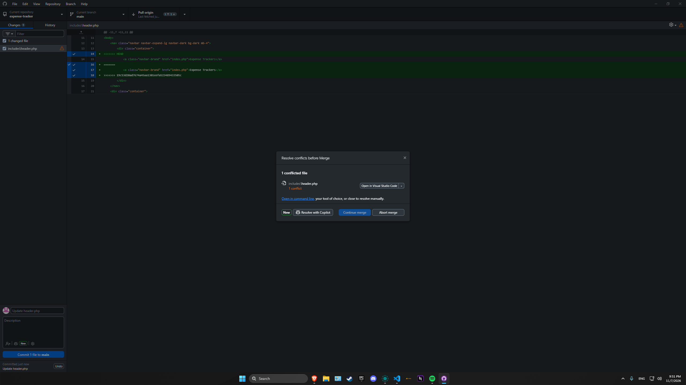
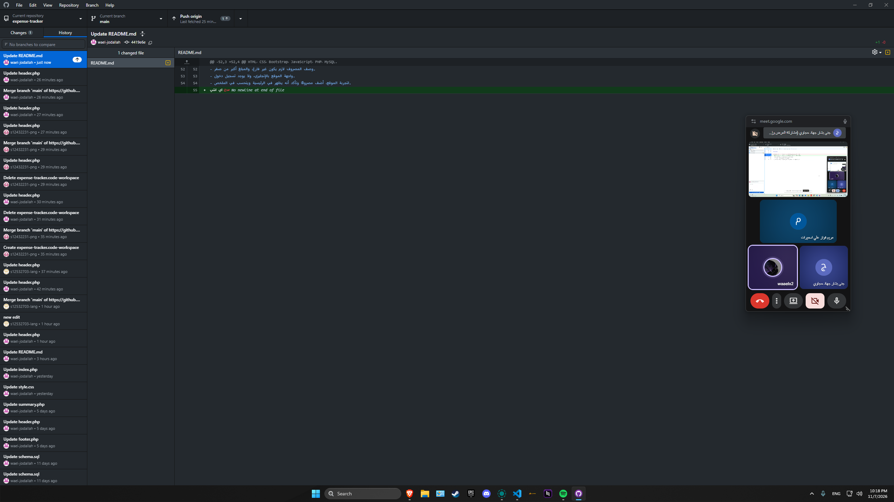
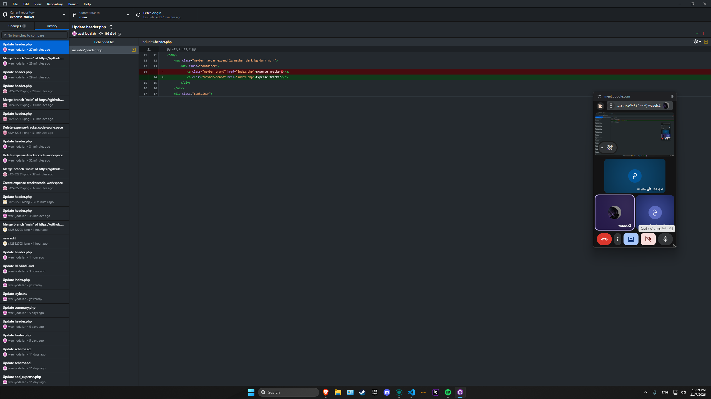

الاسم: وائل جودالله
الدور: B — backend

دوري والملفات التي عملت عليها

كانت مسؤوليتي ربط الموقع بقاعدة البيانات، وعرض المصاريف وإضافة مصاريف جديدة. عملت على الملفات التالية:

* config.example.php: تجهيز قالب بيانات الاتصال بقاعدة البيانات.
* includes/db.php: إنشاء الاتصال بقاعدة البيانات باستخدام PDO.
* public/index.php: عرض المصاريف من الأحدث إلى الأقدم مع المجموع الكلي.
* public/add_expense.php: إنشاء نموذج إضافة المصروف، والتحقق أن الوصف غير فارغ والمبلغ أكبر من صفر، ثم حفظ البيانات والعودة للرئيسية.

أنشأت أيضًا ملف config.php على جهازي، وتأكدت أنه مستثنى من الرفع إلى GitHub.

التعارض وكيف تم حله

(images/)

التراجع عن تعديل خاطئ 

(images/)
(images/)

ضمن تدريب التراجع، كان المطلوب مني رفع تعديل مقصود يسبب خطأ في public/index.php، ثم إخبار الفريق بوجود الخطأ دون تحديد التعديل.

أصعب شيء في العمل الجماعي

منع حدوث تعارض و انتظار الزملاء في التقدم